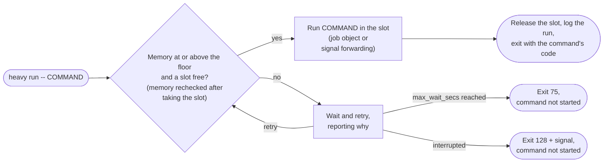

# heavy-gate

Run builds and renders through a shared slot and free-memory gate on Windows, Linux, and macOS.

Agent sessions, their subagents, and scripts can each start a reasonable build and exhaust RAM together. No single session can see all the others. `heavy run -- COMMAND` coordinates cooperating callers: a command starts only when a slot is free and available physical memory meets the configured floor.

The `heavy` executable runs locally, requires no service or account, and makes no network requests. The project is maintained by [vsolano9](https://github.com/vsolano9) and licensed under the [MIT license](LICENSE), copyright TheChosenVictor LLC.

## Install

### Release archives

The v1.0.0 release asset names are:

| Platform | Asset |
| --- | --- |
| Windows x86-64 | `heavy-v1.0.0-x86_64-pc-windows-msvc.zip` |
| Linux x86-64, glibc | `heavy-v1.0.0-x86_64-unknown-linux-gnu.tar.gz` |
| macOS Apple Silicon | `heavy-v1.0.0-aarch64-apple-darwin.tar.gz` |
| Checksums | `SHA256SUMS` |

The following are download and verification examples for [GitHub Releases](https://github.com/vsolano9/heavy-gate/releases). They require the named assets to have been published; this document does not establish their availability. Verify the archive before extracting it, then put `heavy` or `heavy.exe` in a directory on `PATH`.

Windows, in PowerShell:

```powershell
$release = 'https://github.com/vsolano9/heavy-gate/releases/download/v1.0.0'
$asset = 'heavy-v1.0.0-x86_64-pc-windows-msvc.zip'
Invoke-WebRequest "$release/$asset" -OutFile $asset
Invoke-WebRequest "$release/SHA256SUMS" -OutFile SHA256SUMS
$entry = Select-String -LiteralPath SHA256SUMS -Pattern ([regex]::Escape($asset) + '$')
if (@($entry).Count -ne 1) { throw 'Missing or ambiguous checksum entry' }
$expected = ($entry.Line -split '\s+')[0]
$actual = (Get-FileHash -LiteralPath $asset -Algorithm SHA256).Hash
if ($actual -ine $expected) { throw 'Checksum mismatch' }
Expand-Archive -LiteralPath $asset -DestinationPath heavy-v1.0.0
```

Linux:

```sh
set -eu
release=https://github.com/vsolano9/heavy-gate/releases/download/v1.0.0
asset=heavy-v1.0.0-x86_64-unknown-linux-gnu.tar.gz
curl -fLO "$release/$asset"
curl -fLO "$release/SHA256SUMS"
grep "  $asset\$" SHA256SUMS | sha256sum --check --strict -
tar -xzf "$asset"
```

macOS:

```sh
set -eu
release=https://github.com/vsolano9/heavy-gate/releases/download/v1.0.0
asset=heavy-v1.0.0-aarch64-apple-darwin.tar.gz
curl -fLO "$release/$asset"
curl -fLO "$release/SHA256SUMS"
grep "  $asset\$" SHA256SUMS | shasum -a 256 --check -
tar -xzf "$asset"
```

A checksum verifies integrity against the downloaded manifest. It does not independently authenticate that manifest.

### From source

With Rust 1.85 or later and the platform's native linker installed:

```sh
cargo install --git https://github.com/vsolano9/heavy-gate --tag v1.0.0
```

For a local checkout, use `cargo install --path .`. Cargo installs the executable into its bin directory, usually `~/.cargo/bin`; add that directory to `PATH` if needed. Source installation requires the tag or checkout to be available and does not require a crates.io publication.

## Quick start

```sh
heavy init
heavy config
heavy status
heavy run -- cargo build --release
heavy run --label frontend -- npm run build
heavy run --max-wait 300 -- blender --background scene.blend --render-frame 1
```

`init` writes the user configuration and refuses to overwrite an existing file. Configuration is optional: without a file, `heavy` uses defaults derived from RAM and logical CPU count.

`run` inherits the current directory, environment, stdin, stdout, and stderr. It starts a program with its arguments, rather than interpreting a shell command. Wrap only the expensive command in a compound shell line:

```sh
cd app && heavy run -- npm run build
```

When shell syntax must run inside the slot, invoke that shell explicitly:

```sh
heavy run -- sh -c 'make all && make package'
```

```powershell
heavy run -- pwsh -NoProfile -Command 'npm run build; if ($LASTEXITCODE) { exit $LASTEXITCODE }; npm run package'
```

On Windows, executable resolution also supports command shims such as `npm.cmd`, and `.cmd` and `.bat` scripts start directly. Other scripts run through their interpreter:

```powershell
heavy run -- pwsh -NoProfile -File .\build.ps1
heavy run -- python build.py
```

## How it works



Each `heavy run` waits for both a shared slot and enough available memory, rechecks memory after taking the slot, and holds the slot until the child exits. Waiters periodically retry and report why they are waiting. There is no daemon, persistent queue, or FIFO ordering guarantee.

Windows uses `Local` named mutexes whose names include a hash of the canonical state directory, so different spellings of one directory (relative paths, junctions, short names) share one gate. Unix uses `flock` locks in the state directory. Kernel locks are released when their owning process exits, including after a crash. Metadata files describe holders; they are not the lock authority. All cooperating sessions should use the same slot count and the same state directory.

By default, `heavy` sets `CARGO_BUILD_JOBS` and `CMAKE_BUILD_PARALLEL_LEVEL` for the child only when each variable is unset. `--no-jobs-env` disables this. Other build tools need their own parallelism settings.

On Windows, the wrapper joins a [kill-on-close Job Object](https://learn.microsoft.com/en-us/windows/win32/procthread/job-objects) before starting the child so children inherit membership. Where the host forbids that, it starts the child suspended, assigns it to the job, and only then lets it run, so no descendant can start outside the job. If the job cannot be created or the child cannot be assigned, the command is not run and `heavy` exits 127. On Unix, the child remains in the wrapper's process group and the wrapper forwards `SIGINT`, `SIGTERM`, and `SIGHUP` to the child. Linux additionally gives the direct child a [parent-death `SIGKILL`](https://man7.org/linux/man-pages/man2/PR_SET_PDEATHSIG.2const.html). On Windows, Ctrl+C or Ctrl+Break reaches the child through the shared console, and the wrapper itself stays alive to record the run; Ctrl+C while still waiting for admission ends the wait with exit 130, as `SIGINT` does on Unix.

## Commands and exit codes

```text
heavy run [--label TEXT] [--max-wait SECS] [--no-jobs-env] [--] PROGRAM [ARGS...]
heavy status
heavy config
heavy init
heavy check [--subagent] [--powershell] COMMAND
heavy hook
heavy --help
heavy --version
```

| Command | Purpose |
| --- | --- |
| `run` | Wait for admission, run the child, and return its exit status. |
| `status` | Show the memory floor, available memory, slots, and holder metadata. |
| `config` | Show effective settings and configuration location. |
| `init` | Create the user configuration without overwriting an existing file. |
| `check` | Print the hook's `pass` or `deny: ...` verdict without running the command. |
| `hook` | Read one Claude Code hook payload from stdin and emit a denial only when required. |
| `--help`, `--version` | Show usage or the executable version (`help` and `version` aliases also work). |

Place `run` options before the program. `--` ends option parsing. `--max-wait` limits admission wait time, not child runtime. The default label is derived from the command; use `--label` when a shorter or less revealing label is preferable.

| Exit | Meaning |
| --- | --- |
| Child's exit code | The child started and exited normally. |
| `128 + signal` | On Unix, the child terminated by a signal, or the wrapper got `SIGINT`, `SIGTERM`, or `SIGHUP` while waiting for admission and never started it. On Windows, Ctrl+C while waiting returns 130. |
| `75` | Admission timed out. |
| `127` | The child could not be started, or on Windows could not be placed in its cleanup job. |
| `2` | Invalid CLI usage. |
| `1` | A state, slot, signal-handler, initialization, or child-wait operation failed. `config` also returns 1 when the file has problems. |

A child can return these same numbers. `check` reports its verdict in stdout; a denial is not a nonzero check exit status. `hook` reports denials through Claude's JSON protocol.

## Configuration

`HEAVY_GATE_CONFIG` selects a configuration file. Otherwise the default is:

| Platform | Configuration file |
| --- | --- |
| Windows | `%APPDATA%\heavy-gate\heavy-gate.toml` |
| Linux and macOS | `$XDG_CONFIG_HOME/heavy-gate/heavy-gate.toml`, or `~/.config/heavy-gate/heavy-gate.toml` when unset |

The working directory does not select a project configuration. Use `HEAVY_GATE_CONFIG` explicitly if a project needs one. See [heavy-gate.example.toml](heavy-gate.example.toml) for a commented file.

| Key | Default | Meaning |
| --- | --- | --- |
| `slots` | `clamp(floor(RAM GiB / 10), 1, 4)` | Maximum simultaneously admitted commands in the shared slot namespace. |
| `min_free_gb` | `max(2, round(RAM GiB * 0.15))` | Available physical memory required at admission, in GiB despite the key's historical name. |
| `jobs` | `max(1, logical CPUs / slots)` | Integer parallelism hint for Cargo and CMake. |
| `max_wait_secs` | `3600` | Maximum admission wait. |
| `state_dir` | Platform path below | Holder metadata, Unix locks, and local run log. |
| `subagent_builds` | `"deny"` | Hook policy: `"deny"` rejects subagent builds even when wrapped; `"gate"` allows them when wrapped. |
| `hook.extra_build_programs` | `[]` | Additional plain executable names treated as builds. |
| `hook.extra_heavy_programs` | `[]` | Additional plain executable names that require wrapping. |
| `hook.disabled` | `false` | Make hook checks pass; direct `heavy run` still gates commands. |

Default state directories:

| Platform | State directory |
| --- | --- |
| Windows | `%LOCALAPPDATA%\heavy-gate` |
| Linux | `$XDG_STATE_HOME/heavy-gate`, or `~/.local/state/heavy-gate` when unset |
| macOS | `~/Library/Application Support/heavy-gate` |

Unknown keys and invalid values produce a warning per problem in normal CLI use and retain defaults for those settings. Malformed TOML uses all defaults. `heavy config` prints every effective value with its source (`file`, `default`, or `auto`) and returns 1 when the file has problems. The hook prints no warnings and uses the same effective values, so a typo cannot switch enforcement off; set `[hook] disabled = true` to turn it off. `heavy check` still shows the verdict using effective values and reports configuration warnings. Use both after editing the file. Configuration is reread on each invocation.

`slots` accepts integers from 1 to 1024; `jobs` accepts positive 32-bit integers; `max_wait_secs` accepts nonnegative integers. `min_free_gb` accepts finite nonnegative numbers, including zero to disable the memory floor. A zero wait still attempts immediate admission once. If total memory cannot be read, auto sizing uses 8 GiB. Use an absolute `state_dir`: relative paths depend on the caller's working directory, and neither `~` nor environment variables are expanded inside TOML strings.

Additional program entries are names such as `mybuilder`, not paths, shell fragments, or regular expressions. The build list also participates in the subagent policy; the heavy list only requires gate wrapping.

## Claude Code hook

Merge a `PreToolUse` entry into your user `~/.claude/settings.json` or project `.claude/settings.json`. Ensure the executable is on the environment's `PATH`, or use an absolute executable path. JSON needs Windows backslashes doubled (`"C:\\Tools\\heavy.exe"`), or use forward slashes (`"C:/Tools/heavy.exe"`).

Windows, using direct execution:

```json
{
  "hooks": {
    "PreToolUse": [
      {
        "matcher": "Bash|PowerShell",
        "hooks": [
          { "type": "command", "command": "heavy.exe", "args": ["hook"] }
        ]
      }
    ]
  }
}
```

Linux and macOS:

```json
{
  "hooks": {
    "PreToolUse": [
      {
        "matcher": "Bash|PowerShell",
        "hooks": [
          { "type": "command", "command": "heavy hook" }
        ]
      }
    ]
  }
}
```

The [official Claude Code hook reference](https://code.claude.com/docs/en/hooks#exec-form-and-shell-form) specifies a string `command` with an optional `args` array for exec form. A `command` array is not that schema. The Unix example uses shell form; it can also use `"command": "heavy", "args": ["hook"]`. Use a Claude Code version supporting exec form for the Windows example.

The hook denies recognized unwrapped build and heavy commands with a suggested `heavy run --` prefix. It recognizes common Rust, C/C++, .NET, Java, JavaScript, Go, Swift, and Zig build commands, build scripts, Blender, and Remotion and HyperFrames `render` commands. `ffmpeg` is not a default match. Help and version probes pass. Quoted data and here-documents are handled heuristically to reduce false positives. A wrapper only covers its own command: `heavy run -- cargo build && make` still denies the unwrapped `make`. Commands larger than 1 MiB are not parsed; they deny if a recognized build appears anywhere in them. Hook payloads larger than 8 MiB and shell bodies nested past 32 levels are outside the classifier's limits and pass without inspection of the excluded input.

An `agent_id` in the payload identifies a subagent. With `subagent_builds = "deny"`, a build is denied even inside `heavy run`; the subagent should hand its build command back to the lead. Set `"gate"` to permit gated subagent builds. The hook does not install itself or modify another tool's settings.

Inspect decisions without running a build:

```sh
heavy check 'cargo build --release'
heavy check 'heavy run -- cargo build --release'
heavy check --subagent 'heavy run -- cargo build --release'
heavy check 'ffmpeg -i input.mp4 output.mp4'
```

```powershell
heavy check --powershell '& "C:\Tools\cargo.exe" build'
heavy check --subagent --powershell 'heavy run -- cargo build'
```

With defaults, these print deny, pass, deny, pass, deny, and deny respectively. `check --powershell` applies PowerShell quoting rules; `check --subagent` simulates subagent identity.

## Other agents, scripts, and build systems

Codex, Cursor, and Aider can use the same executable without Claude's hook protocol. Put this instruction in the tool's project instructions: “Run builds, compiles, and renders with `heavy run --`; keep the wrapper running until the command exits.” Configure task commands to invoke the wrapper directly where supported. This is a workflow convention unless that tool separately enforces it. CI scripts and Makefiles can use the same wrapper when concurrent jobs share a user and state directory; separate runners have separate gates.

Shell script:

```sh
#!/bin/sh
exec heavy run --label release -- cargo build --release
```

PowerShell script:

```powershell
& heavy run --label release -- cargo build --release
exit $LASTEXITCODE
```

Makefile recipe, with a literal tab before `heavy`:

```make
.PHONY: release
release:
	heavy run -- cargo build --release
```

Wrap at one orchestration layer. Nested `heavy run` calls can consume every slot while their children wait for another slot.

## Local records

`runs.jsonl` in the state directory is an append-only JSON Lines log. A completed run has this shape; values below are illustrative:

```json
{"ts":1792022400,"event":"run","label":"release","cwd":"/workspace/project","slot":0,"pid":1234,"waited_s":2,"ran_s":12,"exit":0}
```

`ts` is Unix time in seconds, durations are whole seconds, `slot` is zero-based, and `pid` identifies the wrapper. A timeout record contains `ts`, `event: "timeout"`, `label`, `pid`, `exit: 75`, and `waited_s`; fields for an admitted run are absent. An interrupted or failed admission after state setup uses `event: "admission_error"` and its exit code. A child start failure is a `run` record with `exit: 127`. Holder files include the label, working directory, process ID, slot, and start time. A reserved kernel lock serializes log appends; logging failures warn and do not change the command's exit code.

Labels and working directories can contain private information. Logs stay local, are not rotated automatically, and should be redacted before sharing. Abrupt termination can leave stale metadata or omit the final run record. Slot availability comes from the OS lock, not a completed log entry.

## Limits and FAQ

**Does the memory floor prevent out-of-memory failures?** It controls admission only. It neither reserves memory nor limits a running child's allocations. Several admitted commands can grow after their memory checks. Tune slots, the floor, and tool parallelism for the workload.

**Is this machine-wide across all users?** Coordination is intended for one user's cooperating sessions. Slots are scoped by the state directory on every platform, and on Windows also by the logon session (`Local` mutexes). Separate users, Windows logon sessions, containers, or state directories have separate gates.

**How is available memory measured?** Windows uses `GlobalMemoryStatusEx` available physical memory. Linux reads `/proc/meminfo` `MemAvailable`, falling back to `MemFree + Buffers + Cached` if absent; total memory is `MemTotal`. macOS reads `hw.memsize` and multiplies it by the kernel's `kern.memorystatus_level` percentage. The macOS value is a system availability estimate rather than an exact reclaimable-byte count. If the available-memory query fails, the floor is treated as satisfied with one warning to stderr per invocation. `status` shows unknown for unavailable readings.

**What happens when the wrapper dies?** Its slot lock is released. The Windows Job Object terminates its descendants. On Windows the job also ends descendants that are still running when the wrapper exits normally, so a build daemon meant to outlive the build (a Gradle daemon, an sccache server) should be started outside `heavy run`. Linux's parent-death signal covers the direct child. Unix descendants can outlive the wrapper or escape the original process group, especially after abrupt termination; their work can continue after the slot becomes free. Unix signal forwarding is not full process-tree containment.

**Is the hook a security boundary?** No. It uses command heuristics, can miss indirect or unusual invocations, and fails open on malformed hook input. It only sees configured Bash and PowerShell tool events. Direct wrappers provide coordination for commands that actually use them; use OS isolation and tool permissions for enforcement against untrusted commands.

**Why not cgroups or systemd-run?** Linux [cgroup v2](https://docs.kernel.org/admin-guide/cgroup-v2.html) provides resource accounting and limits, including `memory.max`. [`systemd-run`](https://www.freedesktop.org/software/systemd/man/latest/systemd-run.html) runs commands in transient units and can apply resource-control properties. They complement admission gating when you need runtime memory limits and stronger lifecycle management. `heavy` provides a shared wrapper across the three supported OS families.

**Why not Task Spooler or Pueue?** [Task Spooler](https://viric.name/soft/ts/) queues shell jobs and supports concurrent slots; [Pueue](https://github.com/Nukesor/pueue) is a background task manager with queues, parallelism, and process controls. Use them when you need persistent task management. `heavy` keeps the caller attached and combines shared slots with a free-memory admission check. Avoid layering queues without considering their combined concurrency and nested waits.

**Why is a command still waiting?** Run `heavy status`. A slot may be occupied, or available memory may be below the floor even with every slot free. `--max-wait` changes the wait limit for one run. A timed-out command was never started.

**Can I remove stale holder files?** First inspect `heavy status`. A leftover metadata file does not hold a slot. On Unix, do not delete or replace active lock files: processes can otherwise lock different inodes under the same filename. Do not clear a state directory while wrappers are running.

For changes and reporting, see [CHANGELOG.md](CHANGELOG.md), [CONTRIBUTING.md](CONTRIBUTING.md), and [SECURITY.md](SECURITY.md).
